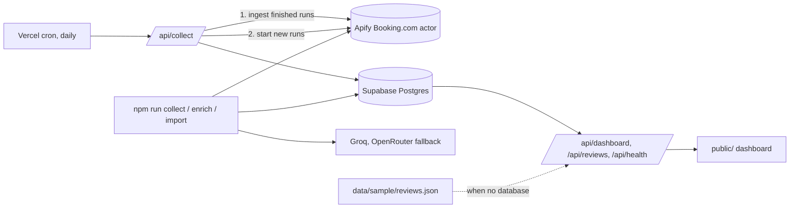

# Azzurro Review Insights

Collects public Booking.com guest reviews for four Azzurro Hotels properties in Sydney, and turns them into a dashboard that operations staff can read without training: this week's rating, how it compares with last week, how each property is doing, and what guests keep complaining about.

| Property | Booking.com page |
|---|---|
| Olympic Hotel Paddington | [olympic-paddington](https://www.booking.com/hotel/au/olympic-paddington.html) |
| Potts Point | [venus-potts-point-sydney](https://www.booking.com/hotel/au/venus-potts-point-sydney.html) |
| Central Sydney | [venus-surry-hills](https://www.booking.com/hotel/au/venus-surry-hills.html) |
| Darling Harbour | [chateau-de-venus](https://www.booking.com/hotel/au/chateau-de-venus.html) |

**Live demo:** https://booking-kpi.vercel.app (reads the live database; served from Singapore, next to it).

## Quick start

Requires Node 20 or newer.

```bash
npm install
cp .env.example .env        # fill in values, see "Configuration"
npm test                    # unit tests, no network needed
npm run dev                 # http://localhost:3000
```

Without Supabase credentials the dashboard reads `data/sample/reviews.json`: 375 real reviews collected from the four Booking.com pages, with their AI topic tags, exported from the database on 10 October 2026. With credentials it reads the live database. To rebuild a database from the repository, apply `supabase/migrations/0001_init.sql` and run `npm run seed`.

> **Data status, read first.** The first collection did not fetch the newest reviews for Potts Point, Central Sydney and Darling Harbour (see Known limitations). Olympic Hotel Paddington's data is current. The dashboard says so on screen: the Data health tab flags each affected property, and the Overview warns that those numbers are incomplete.

### Collecting reviews

```bash
npm run collect                       # start one Apify run per property, wait, ingest
npm run enrich                        # AI topic tagging for new reviews
npm run export-sample                 # refresh data/sample/reviews.json from the database
npm run seed                          # load data/sample into an empty database
npm run ingest-run -- <apifyRunId>    # re-ingest a finished Apify run
npm run import -- file.csv --property darling-harbour   # fallback: load an export by hand
npm run snapshot                      # this week's KPIs and insights in the terminal
npm run label-template                # pick 100 reviews for hand labelling (accuracy test)
npm run eval                          # AI and keyword baseline vs the hand labels
npm run scan                          # check for key-like strings before pushing
```

In production a daily Vercel cron calls `GET /api/collect` (protected by `CRON_SECRET`). Each call ingests the runs started the day before, starts new ones, then AI-tags new reviews. One function call tags about 25; if more are waiting it hands the rest to `GET /api/enrich`, which keeps handing on until none are left, so even a 1,000-review back-fill is tagged within about an hour with no laptop. See [docs/collection-method.md](docs/collection-method.md).

## What the dashboard shows

**Overview tab**

- **Average rating** for the selected period (default: this week to date, Sydney time) with the change against last week, shown with an arrow, a sign and words, not just colour.
- **Reviews published**, split into positive (8+), neutral and negative (below 6).
- **Negative reviews** as a share, with counts ("3 of 23 reviews").
- **Top complaint** with a link straight to those reviews.
- **What stands out**: three to five plain sentences written from the numbers, for example *"40% of negative reviews this week mentioned cleanliness issues (2 of 5)."*
- **Needs attention**: rating drops of 0.5 points or more, a topic's complaints rising by 10 points or more, three negative reviews at one property in 7 days, and serious issues (hygiene, safety, billing).
- **Properties table**: rating, change, volume, share negative and a 12-week sparkline per property. Click a row to focus the whole dashboard on that property. Fewer than 5 reviews shows a "Few reviews" badge.
- **Weekly trends**: positive, neutral and negative reviews per week, and average rating per week, over 12 weeks, with the selected period shaded and a written summary under each chart.
- **Complaint topics**: cleanliness, check-in, staff and reception, noise, facilities, location, room condition, value for money. Click a topic to read those reviews.

**Reviews tab**: every review with its rating, property, date, traveller type, country, room, what the guest liked and disliked, AI topic tags, the property's reply and a link to the original. Search, rating filter, topic filter, sort and "load more".

**Data health tab**: per property, how many reviews are stored, the newest review, when data was last collected, how many reviews are analysed, and the outcome of recent collection runs.

Filters (property and period, including a custom date range) apply across tabs and are kept in the URL, so a filtered view can be shared as a link.

## Architecture



| Path | Role |
|---|---|
| `app.js` | One request handler, shared by `server.js` (local) and `api/index.js` (Vercel) |
| `dashboard.config.js` | Properties, topics and their labels, thresholds, time zone, attention rules |
| `lib/analytics.js` | Every dashboard number and sentence, as pure functions over a list of reviews |
| `lib/weeks.js` | Sydney calendar maths: weeks start Monday, daylight saving handled |
| `lib/repository.js` | Data sources: Supabase (paged reads) or the sample file |
| `lib/normalize.js`, `lib/validate.js`, `lib/dedupe.js`, `lib/ingest.js` | Source row to clean, privacy-safe review; validation; duplicate detection; idempotent upsert |
| `lib/apify.js`, `lib/collect.js` | Starting runs with retries and actor failover, ingesting finished runs, recovering stuck ones |
| `lib/enrich.js`, `lib/llm.js` | AI topic tagging with key rotation, provider fallback and an evidence check |
| `lib/auth.js` | Timing-safe secret check, fails closed |
| `public/` | Dashboard: plain HTML, CSS and JavaScript, no build step, charts drawn as inline SVG |
| `supabase/migrations/` | Database schema, row level security on every table |

More detail: [docs/architecture.md](docs/architecture.md).

## How reviews are collected

Booking.com has no public review API, so collection uses a third-party Apify actor that reads the public review pages. Our code never drives a browser.

- **Fields kept**: rating (10-point scale), title, liked text, disliked text, publication date, stay date, country, traveller type, room, nights, the property's reply, review link. Reviewer names are dropped in `lib/normalize.js` and never stored.
- **No duplicates**: each review gets a key, Booking's review id from the review link when present, otherwise a hash of property, date and text. The database enforces one row per property and key. Re-collecting the same review only updates "last seen"; an edited review or a new reply is detected by a content hash and updated.
- **Three actors, in order**: `apt_marble`, then `omkar-cloud`, then `scrapeunblocker`, from different vendors. A property moves to the next actor when one will not start, fails, returns nothing, returns only old reviews or returns scores on the wrong scale. Each actor's input is built from its own published schema.
- **New reviews**: each run asks for reviews newest first, published since the newest stored review minus 14 days. Anything already stored is recognised and skipped, including the same review collected by a different actor.
- **Failures**: bounded retries with backoff on network errors; a fallback actor if the primary one cannot start; a failed, empty or mostly rejected run is recorded as `failed` or `degraded` and existing data is never deleted or overwritten; runs left `running` are picked up on the next collection; invalid rows are rejected with a reason and logged, without stopping the run.
- **Fallback**: `npm run import` loads a CSV or JSON export through the same validation path.

Full write-up, including reliability and terms-of-service considerations: [docs/collection-method.md](docs/collection-method.md).

## Where AI is used

AI is used in one place: **tagging each review with topics**. The rest is plain arithmetic, so every number can be checked by hand.

| Part | Uses AI? |
|---|---|
| Topic tags on reviews (cleanliness, noise, staff...) | Yes: Groq `qwen/qwen3.8-27b`, OpenRouter `qwen/qwen-2.5-7b-instruct` as fallback |
| Ratings, averages, week-on-week changes, positive/negative split | No: the guest's own score |
| "What stands out" sentences and "Needs attention" flags | No: written by fixed rules from the numbers, so they never invent facts |

Tagging runs at collection time (daily cron, and `npm run enrich`), never while someone is looking at the dashboard, so the dashboard is fast and works when AI providers are down.

## How topics are found

An AI model (Groq, with OpenRouter as fallback) reads each review's title, liked and disliked text and returns topics, each with a polarity (complaint or praise), a severity from 1 to 3 and a short quote as evidence. Tags whose quote does not appear in the review are thrown away, which blocks invented tags. Reviews with no text are counted by rating only. Method and limits: [docs/insights-methodology.md](docs/insights-methodology.md).

## Metric definitions

| Metric | Definition |
|---|---|
| Review date | When the review was published on Booking.com |
| Week | Monday to Sunday, Sydney time |
| Average rating | Mean score out of 10 of reviews published in the period |
| Comparison | "This week" is compared with all of last week; other periods with the period of the same length just before |
| Positive / negative | 8 or more / below 6. Configurable in `dashboard.config.js` |
| Complaint share (topic) | Reviews with a complaint about the topic, divided by all reviews in the period |
| Share of negative reviews (topic) | Negative reviews with a complaint about the topic, divided by all negative reviews |
| Few reviews | Fewer than 5 reviews in the period. Flagged, never hidden |

## Configuration

| Variable | Needed for |
|---|---|
| `SUPABASE_URL`, `SUPABASE_SERVICE_ROLE_KEY` | Live data. Server-side only |
| `APIFY_API_TOKEN`, `APIFY_ACTOR_ID` | Collection. Actor IDs in fallback order: `apt_marble/booking-reviews-scraper,omkar-cloud/booking-reviews-scraper,scrapeunblocker/booking-reviews-scraper` |
| `GROQ_API_KEYS`, `OPENROUTER_API_KEYS` | AI topic tagging |
| `CRON_SECRET` | Enables `GET /api/collect`. Unset means the endpoint returns 503 |
| `APIFY_MAX_REVIEWS` | Reviews requested per property per run (default 300) |
| `APIFY_SINCE` | Forces the start date (YYYY-MM-DD) for a one-off backfill; normally the newest stored review minus 14 days |
| `APIFY_INPUT_OVERRIDES` | JSON merged into the actor input, for example the actor's newest-first sort option |
| `SAMPLE_DATA_PATH` | Optional alternative data file when Supabase is not configured |

Database setup: create a Supabase project and run the files in `supabase/migrations/` in order.

## Deploying

Vercel only: static files from `public/`, one function (`api/index.js`, region `sin1`, next to the Supabase database) and a daily cron (`vercel.json`). Environment variables are set for Production only, so preview deployments fall back to the committed sample. Add the variables above in the Vercel project settings, then `vercel deploy --prod`. Make sure Vercel Deployment Protection is off for the public demo.

## Known limitations

- **Third-party collector.** Collection depends on an Apify actor that can break when Booking.com changes its pages or blocks traffic. Drift shows up as `degraded` runs on the Data health tab; the CSV and JSON importer is the manual fallback. Automated collection may be restricted by Booking.com's terms; only public data is read, at low volume.
- **The first actor did not return the newest reviews (VERIFIED; collector replaced, re-collection pending).** The stored data shows it: each property has about 100 reviews spread over up to three years, and the newest stored review at Potts Point is from 26 July 2026 and at Darling Harbour from 31 August 2026. So "this week" is close to empty for most properties until the actor is told to sort newest first. The sort option's exact input name has to be read from the actor's Apify page and set in `APIFY_INPUT_OVERRIDES`. Runs that return nothing from the last 21 days are now marked "Partial" on the Data health tab, so this can no longer go unnoticed.
- **Collection lag.** The cron starts runs one day and ingests them the next, so the dashboard is up to about a day behind Booking.com.
- **AI tagging is not perfect.** Sarcasm, mixed sentences and very short reviews are hard. The evaluation tooling is built (`npm run label-template`, `npm run eval`), but the 100 hand labels have not been done yet, so precision and recall are not measured.
- **Low volumes.** Each property gets only a handful of reviews a week, so weekly averages move a lot. The dashboard flags small samples instead of hiding them.
- **Doubled low scores (fixed).** An early bug stored the 46 worst reviews as 8 to 10 out of 10. The code is fixed with a test and the stored rows were corrected; details in [docs/collection-method.md](docs/collection-method.md#incidents).
- **Sample data is a snapshot.** `data/sample/reviews.json` is an export from 10 October 2026 and does not update by itself. Refresh it with `npm run export-sample` after collecting.

## Security and privacy

- No secrets in the repository; `.env` is ignored and `npm run scan` checks for key-like strings.
- The browser never talks to Supabase. Every table has row level security on with no public policies; the server uses the service role key.
- Reviewer names are never stored, logged or shown. Review text is kept in its original language.
- All review text is escaped before display.

## Documentation

| File | Content |
|---|---|
| [docs/architecture.md](docs/architecture.md) | Components and data flow |
| [docs/collection-method.md](docs/collection-method.md) | Source, dedupe, incremental updates, failure handling, limits |
| [docs/insights-methodology.md](docs/insights-methodology.md) | Topic tagging, validation, metrics, limits |
| [docs/decisions.md](docs/decisions.md) | Decisions and their trade-offs |
| [docs/known-unknowns.md](docs/known-unknowns.md) | What is not verified yet, and how to verify it |
| [docs/operations.md](docs/operations.md) | Runbook: daily checks, commands, what to do when something breaks |
| [docs/data-dictionary.md](docs/data-dictionary.md) | Tables and fields |
| [docs/progress-log.md](docs/progress-log.md) | Timestamped progress updates |

## License

MIT, see [LICENSE](LICENSE).
